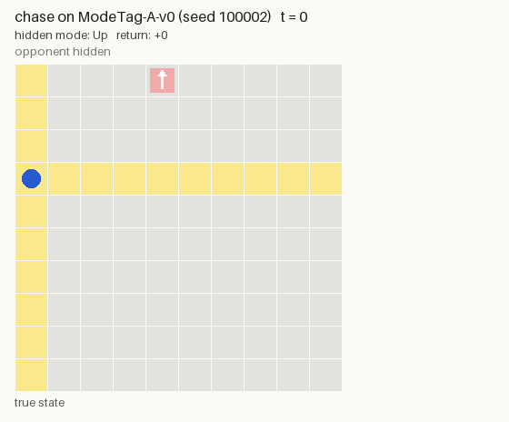
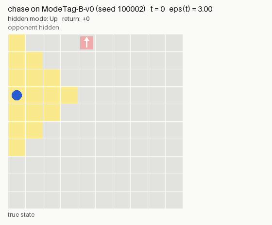

# Time-varying Tag POMDP (ECE 595 project)

Gymnasium simulation of the tag game in Sec. IV of the final report: a robot chases an
opponent on an open 10 × 10 grid. The opponent's motion is driven by a **hidden mode**
(experiment A: time-varying hidden-state dynamics). The opponent is only visible within a
**time-varying radius ε(t)** (experiment B: time-varying observation function).

The original Tag game of Pineau, Gordon & Thrun (IJCAI 2003) is still included as a legacy
reference env (see [Legacy: Pineau Tag](#legacy-pineau-tag)).

```bash
conda activate robo
pip install -e .            # or: export PYTHONPATH=$PWD
pytest -q tests
python examples/random_rollout.py --env ModeTag-B-v0
python examples/evaluate.py --env ModeTag-A-v0 --policy chase --episodes 500 --out results/chase_A.csv
python examples/evaluate.py --env ModeTag-A-v0 --policy chase --set p_o=0.6 --set p_m=0.95
python examples/sweep_mode_tag.py --policies chase --episodes 300 --out results/sweep_A.csv
python examples/animate_mode_tag.py --env ModeTag-A-v0 --policy chase --out results/anim_A_chase.gif
```

```python
import gymnasium as gym, tag_env
env = gym.make("ModeTag-A-v0", obs_mode="vector")
obs, info = env.reset(seed=0)
obs, reward, terminated, truncated, info = env.step(env.action_space.sample())
```

## The game (`ModeTagEnv`, `tag_env/mode_tag.py`)

| | |
|---|---|
| Grid | open `size × size` grid (default 10 × 10 = 100 cells), cell = `y * size + x` |
| State | s = (robot cell x, opponent cell y, opponent mode m), m ∈ {up, down, left, right}: 40,000 states |
| Actions | `0 Up, 1 Down, 2 Left, 3 Right`. No Tag action. Moving into the boundary = stay |
| Opponent | ignores the robot. W.p. `p_o` it moves in the direction of its mode; otherwise it stays or moves in one of the other 3 directions, each w.p. (1 − p_o)/4. Boundary = stay |
| Mode | stays the same w.p. `p_m`, else switches to one of the other 3 uniformly. Or a fixed schedule m(t) via `mode_schedule` |
| Capture | checked **after both agents move**: if they share a cell, reward +10 and the episode **terminates** |
| Reward | otherwise `reward="sparse"` (default): −1; `reward="dense"`: −d(x, y) |
| Observation | robot cell always; opponent cell only when visible, else hidden (−1). `observation="row_col"` (A): same row or column. `observation="radius"` (B): d(x, y) **≤** ε(t) |
| Distance | Manhattan (`distance_metric` can be `euclidean` / `chebyshev`) |
| Start | robot and opponent uniform and independent, opponent re-drawn until it differs from the robot; mode uniform |
| Horizon | `max_steps=100`, then `truncated=True`; `gamma=0.95` (used by the discounted-return metric) |

The agent never observes the mode or ε(t). Those values appear only in the privileged `info`
dict (`mode`, `hidden_index`, `p_o`, `p_m`, `eps`), for teacher–student / asymmetric-critic
training. Don't feed `info` to the policy.

**Knobs.** `p_o` is how reliably the opponent follows its mode: higher means more
predictable. `p_m` is how likely the mode is to stay the same each step: higher means it
switches **less** often (the expected run length is 1 / (1 − p_m) steps).

**ε(t) for experiment B is a placeholder.** The default is `simple_eps(t) = 3 + 2 sin(2πt/50)`
(between 1 and 5, two cycles per episode, the same every episode). Its final form isn't
decided yet. `eps` accepts any number, `Schedule` or `fn(t, rng)`, so swapping it needs no
code change:

```python
from tag_env import ModeTagEnv, Piecewise, RandomWalk
ModeTagEnv(observation="radius", eps=2.0)                              # constant radius
ModeTagEnv(observation="radius", eps=Piecewise([50], [4.0, 2.0]))     # switch at t = 50
ModeTagEnv(observation="radius", eps=RandomWalk(low=1, high=5, step_std=0.3))
ModeTagEnv(observation="radius", eps=lambda t, rng: 1 + (t % 20 < 10) * 3)
```

`p_o` and `p_m` accept the same types, so the opponent's behaviour can also change over time.
Schedules are sampled once per `reset()` from the env RNG, so a seed fixes the whole episode.
Available schedules (`tag_env.schedules`): `Constant`, `PerEpisode`, `IID`,
`RegimeSwitching`, `Sinusoid`, `RandomWalk`, `Piecewise`, `FunctionSchedule`.

**Timing.** o_t is generated from s_t with ε(t). The step s_t → s_{t+1} uses p_o(t) and p_m(t).

### Registered configs (`tag_env/presets.py`)

| id | Observation | Opponent | Experiment |
|---|---|---|---|
| `ModeTag-A-v0` | same row / column | p_o = 0.8, p_m = 0.9 | A: time-varying hidden state |
| `ModeTag-B-v0` | d ≤ ε(t), `simple_eps` | p_o = 0.8, p_m = 0.9 | B: time-varying observation |

Any argument can be overridden: `gym.make("ModeTag-A-v0", p_o=0.6, p_m=0.95, reward="dense")`.

### Encodings

- `obs_mode="discrete"`: `Discrete(10100)`, index `robot * 101 + opp_obs` (`opp_obs = 100`
  means hidden).
- `obs_mode="vector"`: one-hot(robot, 100) ++ one-hot(opp_obs, 101), optionally
  `++ t / max_steps` (`obs_include_time=True`).

### Model components (where to change P, Z, R)

`step()` and the exact model are both built from these methods, so the simulator and the
planner model can't disagree:

| Method | Meaning |
|---|---|
| `transition(state, action, t, rng)` | sample s_{t+1}: robot move, opponent move by mode, mode switch |
| `reward(state, action, next_state)` | r_t from the post-move state |
| `observation_probs(state, action, t)` | Z_t as `{opp_obs: prob}` (visibility rule in `_visible`) |
| `observe(state, action, t, rng)` | sample from `observation_probs` |

`state` is a `ModeTagState(robot, opponent, mode)`. The opponent move distribution lives in
`_opponent_moves(mode, p_o)`, which both `transition` and the kernel use.

### Exact model (belief tracking)

The robot's cell is observed and the opponent ignores the robot. So a belief only needs to
cover the 400 hidden values h = (opponent cell, mode), with index `h = opp * 4 + mode`:

```python
env = gym.make("ModeTag-A-v0").unwrapped
obs, info = env.reset(seed=0)
robot, opp_obs = divmod(obs, 101)
b = env.initial_belief(robot, opp_obs)        # over h, given o_0
K = env.opponent_kernel(t)                    # K_t[h, h'], the same for every action
b = env.belief_update(b, robot_next, opp_obs_next, t)
R = env.reward_table()                        # R[x', h'] on the post-move state
```

## Metrics and evaluation

`TagMetrics` (a wrapper) records for every episode: return, discounted return, length,
`tagged` (= captured), truncated, `visible_fraction` (share of decision steps with the
opponent visible), `estimation_error` and `mode_accuracy`. `estimation_error` is the mean
‖x̂_opp − x_opp‖ in grid units, and `mode_accuracy` is the share of steps where the most
likely mode is the true one. Both are filled only if the method calls `env.log_estimate(...)`,
with a cell, an (x, y) pair, or a belief over h. `summarize` adds the capture rate (mean of
`tagged`) and `capture_time` (mean length of captured episodes). `failed_tags` only applies
to the legacy game.

`evaluate(policy, env_id, seeds=EVAL_SEEDS[:n], env_kwargs=...)` runs any `Policy`
(`reset / act / update / opponent_estimate`) on the shared evaluation seeds `EVAL_SEEDS`
(100000–100999). A seed fixes the start state, the mode and the schedules, so every method
sees the same episodes. Don't train on `EVAL_SEEDS`.

Baseline (`tag_env/mode_baselines.py`): `ChaseLastSeenPolicy` heads for the cell where the
opponent was last seen; once there, or if it has never seen the opponent, it moves randomly.
It uses only the observation, has no model of p_o, p_m or ε(t), and needs no training.

```python
from tag_env import evaluate, EVAL_SEEDS
from tag_env.mode_baselines import ChaseLastSeenPolicy
records, summary = evaluate(ChaseLastSeenPolicy(), "ModeTag-A-v0", seeds=EVAL_SEEDS[:500])
```

### Baseline results

Chase policy, 500 episodes per config (`examples/evaluate.py`; per-episode CSVs in
`results/`):

| Config | Disc. return | Capture rate | Length | Opponent visible |
|---|---|---|---|---|
| A | −5.88 ± 0.36 | 99.0% | 21.6 | 44.1% |
| B | −7.54 ± 0.42 | 89.2% | 32.8 | 43.7% |

`examples/sweep_mode_tag.py --policies chase` sweeps p_o ∈ {0.4, 0.6, 0.8, 1.0} ×
p_m ∈ {0.5, 0.8, 0.9, 0.95, 1.0} (`results/sweep_A.csv`). The chase policy captures 94–100%
of the time in every cell, and its discounted return ranges from −7.30 (p_o = 1, p_m = 0.5)
to −4.44 (p_o = 1, p_m = 0.95). With these defaults the game is easy, so the settings may
need retuning (e.g. a larger grid) before the RL comparison.

## Animation

`examples/animate_mode_tag.py` plays one episode with the chase policy and saves it as a GIF:

```bash
python examples/animate_mode_tag.py --env ModeTag-A-v0 --policy chase --out results/anim_A_chase.gif
python examples/animate_mode_tag.py --env ModeTag-B-v0 --policy chase --seed 100010 --out results/anim.gif
```

| Experiment A (seed 100002: captured in 33 steps) | Experiment B (seed 100002: not captured in 100 steps) |
|---|---|
|  |  |

- **Blue dot:** robot. **Red square:** opponent, solid when the robot can see it, faded when
  hidden. **White arrow:** the opponent's hidden mode. **Yellow:** cells the robot can see
  right now, a cross (row and column) in A and a diamond of radius ε(t) in B.
- **Header:** t, ε(t) (B only), the hidden mode, the last action and reward, and the running
  return.

Options:
- `--seed`: a specific episode. Without it, the script uses the first evaluation seed whose
  episode lasts at least `--min-length` steps (default 20).
- `--ms`: milliseconds per frame (default 450).

The B example is one of the ~11% of episodes where the chase policy never catches the
opponent: once it reaches the last sighting without seeing the opponent, it falls back to
random moves, and the opponent drifts out of range.

## Legacy: Pineau Tag

`TimeVaryingTagEnv` (`tag_env/env.py`) is the original 29-cell Tag game from Pineau et al.
(2003): 870 states, a Tag action, an opponent that flees, and visibility `dist < d(t)`. It
has time-varying extensions (d(t), detection probability, opponent speed, p_move). It is kept
as a reference and sanity check (registered as `Tag-Pineau-v0`, `Tag-Static-v0`,
`Tag-TVObs-v0`, `Tag-TVOpp-v0`, `Tag-TV-v0`). It has the same structure:
`reward / transition / observation_probs / observe`, an exact model `model(t)` with
`T[a,s,s']`, `Z[s,o]`, `R[s,a]`, and `belief_update`.
